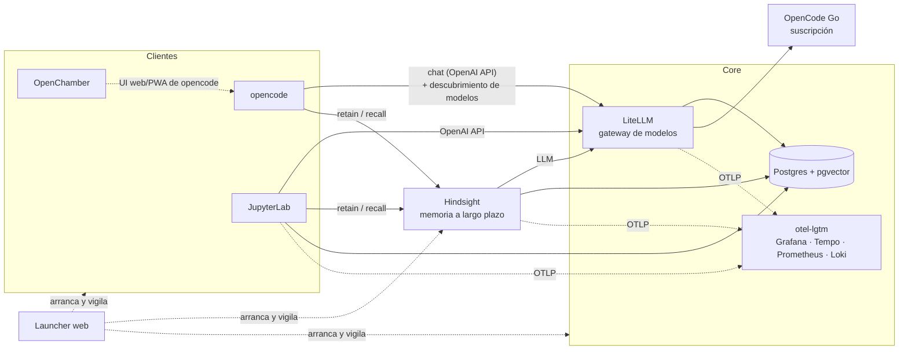

# Documentación técnica de genai-local-stack

genai-local-stack es un entorno local para trabajar con IA generativa. Reúne en una sola máquina un gateway de modelos, clientes (notebooks y agentes de código), memoria a largo plazo, base de datos vectorial y observabilidad, con cuatro principios:

- **Aislado**: cada servicio se instala y guarda su estado dentro de su carpeta. Nada se instala globalmente ni se mezcla con `~/.config` o `~/.local`.
- **Reproducible**: versiones fijadas con lockfiles (`uv.lock`, `package-lock.json`) o tags de imagen. `update.sh` las sube de forma explícita.
- **Distribuible**: en git solo van scripts, lockfiles y plantillas (`*.example*`). La configuración real y los datos son locales.
- **Conectado sin pasos manuales**: `setup.sh` genera claves y propaga URLs y credenciales entre servicios.

La guía de uso rápida (instalación, arranque, puertos) está en el [README del repositorio](../README.md). Aquí se explica cómo funciona cada pieza y cómo se integran.

## Arquitectura



- **LiteLLM** es el único punto de salida hacia los proveedores. Los clientes hablan con él usando la API de OpenAI y una clave del stack, nunca con las claves de los proveedores.
- **opencode** descubre los modelos de LiteLLM con un plugin propio ([opencode-litellm-provider](integraciones/opencode-litellm.md)).
- **Hindsight** da memoria persistente a opencode y a los notebooks, y usa LiteLLM como LLM.
- **Postgres** guarda el estado de LiteLLM (claves, gasto, modelos añadidos por la UI), los bancos de memoria de Hindsight y la BD `genai` de trabajo.
- **otel-lgtm** recibe trazas, métricas y logs por OTLP.

## Convenciones

### Una carpeta por servicio

```
apps-data-and-config/
├── <servicio>/            postgres, otel-lgtm, litellm, hindsight, jupyterlab, opencode, openchamber, launcher
│   ├── app/               definición de la instalación (pyproject.toml + uv.lock, package.json +
│   │                      package-lock.json o compose.yaml) e instalación (.venv, node_modules)
│   ├── config/            plantillas *.example* (versionadas) y config real (local)
│   ├── data/              estado generado: BD, sesiones, logs, caché (local)
│   ├── install.sh         instala desde el lockfile y crea la config que falte desde las plantillas
│   ├── update.sh          sube a la última versión y regenera el lockfile
│   └── start.sh           arranca el servicio aislado (los de Docker, además, stop.sh y compose.sh)
└── opencode-plugins/      plugins propios de opencode (sin dependencias de ejecución)
```

### Plantillas y config local

`install.sh` copia cada plantilla (`config.example.yaml`, `.env.example`…) a su nombre real (`config.yaml`, `.env`…) solo si no existe. Los ficheros reales, `data/` y `workspace/` están en `.gitignore`. Un cambio de configuración que deba llegar a otros usuarios se hace también en la plantilla.

### `setup.sh`

Ejecuta todos los `install.sh` y después conecta los servicios. Es idempotente:

- Añade a cada `.env` las variables nuevas de su plantilla, sin tocar las existentes.
- Genera los secretos que falten (master key de LiteLLM, password de Postgres).
- Rellena las variables vacías que conectan servicios: `DATABASE_URL`, `OTEL_EXPORTER_OTLP_ENDPOINT`, `LITELLM_BASE_URL`, `LITELLM_API_KEY`, `HINDSIGHT_API_URL`…
- Respeta las variables comentadas (`#VAR=...`): así se desactiva una conexión.

### Aislamiento de las apps

Los servicios Python corren con `uv run --project app/`. Los de Node, desde `app/node_modules`. opencode redirige además las variables XDG a su `data/`, para no mezclar configuración ni sesiones con las del usuario (ver [opencode](servicios/opencode.md)). `workspace/` es el directorio de trabajo de JupyterLab y opencode. Es un repo git propio (lo crea `setup.sh`) que este repositorio no versiona.

## Índice

**Servicios**
- [Launcher](servicios/launcher.md): interfaz web para arrancar, parar y vigilar el stack.
- [LiteLLM](servicios/litellm.md): gateway de modelos, credenciales, modelos y UI.
- [Postgres](servicios/postgres.md): base de datos con pgvector.
- [otel-lgtm](servicios/otel-lgtm.md): backend de OpenTelemetry.
- [Hindsight](servicios/hindsight.md): memoria a largo plazo.
- [JupyterLab](servicios/jupyterlab.md): notebooks conectados al stack.
- [opencode](servicios/opencode.md): agente de código.
- [OpenChamber](servicios/openchamber.md): interfaz web/PWA para opencode.

**Integraciones**
- [opencode ↔ LiteLLM](integraciones/opencode-litellm.md): plugin `opencode-litellm-provider` (descubrimiento dinámico de modelos).
- [opencode ↔ Hindsight](integraciones/opencode-hindsight.md): memoria en opencode.
- [Observabilidad](integraciones/observabilidad.md): qué envía cada servicio a otel-lgtm y dónde verlo.

**[Referencias](referencias.md)**: documentación oficial y recursos del ecosistema.
